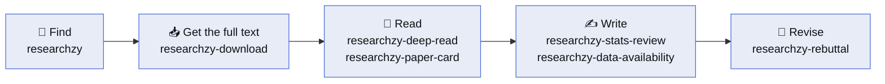

<p align="center">
  <picture>
    <source media="(prefers-color-scheme: dark)" srcset="assets/researchzy-logo-dark.svg">
    
  </picture>
</p>

<h1 align="center">Researchzy Academic Skills</h1>

<p align="center">
  <b>Give your AI agent the skills of a careful researcher — working from real papers.</b><br>
  Find papers among 250 million records, get their full text lawfully, read them closely,<br>
  and prepare your manuscript and your responses to reviewers.
</p>

<p align="center">
  <a href="LICENSE"></a>
  <a href="CHANGELOG.md"></a>
  <a href="#-whats-included"></a>
  <a href="plugins/researchzy/docs/tools.md"></a>
  <a href="#-whats-included"></a>
  <a href="https://agentskills.io/"></a>
  <a href="https://github.com/Researchzy/Researchzy-academic-skills/actions/workflows/tests.yml"></a>
  <a href="#-getting-started"></a>
</p>

---

Researchzy Academic Skills is a plugin of **seven agent skills for the whole life of a paper**: from finding the literature to answering the reviewers. Start with the `researchzy` skill: it searches the literature itself and hands every other task to the skill that fits. It follows the open [Agent Skills](https://agentskills.io/) standard, installs as a single plugin in **Claude Code** and **Codex**, and works in any host that supports Agent Skills. These are the same skills that run inside the [Researchzy Agent](https://researchzy.com).

> ⭐ **If these skills save you an afternoon, please [star the repository](https://github.com/Researchzy/Researchzy-academic-skills).** Stars help other researchers find it and tell us which skills to build next.

## ✨ Why Researchzy

- 📚 **Real papers, not invented citations.** Search returns real bibliographic records from about 250 million scholarly papers across arXiv, PubMed and open-access literature. The reading skills never turn metadata into full-text claims or page numbers.
- 🔓 **Full text, the lawful way.** The PDFs Researchzy holds come first, then open-access copies (PMC, Unpaywall, openly licensed publisher PDFs, arXiv), then full text through *your own* Elsevier, Springer Nature or IEEE API keys. Every attempt is recorded in `manifest.json`.
- 🔍 **Reads like a careful colleague.** A close reading works through the key formulas with concrete numbers and marks where the evidence stops. A Paper Card ties every claim to its experiment and ends with testable research ideas.
- ✍️ **From draft to acceptance.** Audit your statistics, draft the Data and Code Availability statement journals ask for, and turn reviewer comments into a point-by-point response, a cover letter and a LaTeX revision package.
- 🧩 **Works where you work.** One plugin for Claude Code and Codex; `npx skills` or `gh skill` for Cursor, Gemini CLI, GitHub Copilot, Antigravity and 40+ other hosts.
- 🔒 **You stay in control.** The skills run in your agent. Researchzy only answers the literature tools, after you sign in and approve their scopes, and you can disconnect at any time.

## 📦 What's Included

| Skill | What it does |
|---|---|
| 🔎 [`researchzy`](plugins/researchzy/skills/researchzy/SKILL.md) | **Start here.** Search 250M papers by keywords, title, DOI or arXiv ID; filter by year, field and venue; sort by citations; browse and organize your library; fetch PDFs; hand every other task to the skill that fits<br>**You get:** Real metadata and verified local PDFs |
| 📥 [`researchzy-download`](plugins/researchzy/skills/researchzy-download/SKILL.md) | Get full text for a list of DOIs or titles from open access or your own publisher API keys<br>**You get:** Verified PDFs or full text, and a `manifest.json` of every attempt |
| 📖 [`researchzy-deep-read`](plugins/researchzy/skills/researchzy-deep-read/SKILL.md) | Close reading of one paper: how the authors got there, which design choices carry the result, the key formulas with real numbers, how far the evidence reaches<br>**You get:** A Markdown long-read |
| 🗂️ [`researchzy-paper-card`](plugins/researchzy/skills/researchzy-paper-card/SKILL.md) | A structured 16-section analysis of one paper: question, method logic, experiment-to-claim evidence, limitations, critique, research ideas<br>**You get:** A source-anchored `paper-card.md` and an audit report |
| 📊 [`researchzy-stats-review`](plugins/researchzy/skills/researchzy-stats-review/SKILL.md) | Audit a manuscript's statistical reporting: experimental units, replication, uncertainty, tests, figure statistics<br>**You get:** Issues by severity, a ready-to-paste Statistical analysis section, and questions for the authors |
| 🗄️ [`researchzy-data-availability`](plugins/researchzy/skills/researchzy-data-availability/SKILL.md) | Draft or audit Data and Code Availability statements, repository plans and dataset citations<br>**You get:** A ready-to-paste statement, repository and citation actions, and missing-information flags |
| 💬 [`researchzy-rebuttal`](plugins/researchzy/skills/researchzy-rebuttal/SKILL.md) | Turn an editor's letter and reviewer comments into a revision package<br>**You get:** A master tracker, one response per reviewer, a cover letter, and optional LaTeX files |

Only `researchzy` needs a Researchzy account; `researchzy-download` uses it when it is connected. The other five skills work on the PDFs, text and files you give them.

The plugin also connects nine [MCP tools](plugins/researchzy/docs/tools.md): `search_papers`, `get_paper`, `list_collections`, `create_collection`, `list_library_papers`, `add_paper_to_library`, `get_pdf_download`, `create_pdf_upload` and `get_profile`.

## 🔄 One Workflow, from Search to Revision



Use the whole chain or any single step. Start with `researchzy` and it picks the next skill for you. The reading skills fetch papers through `researchzy` when it is installed, and work on local PDFs without it.

## 🚀 Getting Started

### Claude Code

```text
/plugin marketplace add Researchzy/Researchzy-academic-skills
/plugin install researchzy@researchzy
```

Then run `/mcp`, choose **researchzy** and sign in to your Researchzy account. Ask in plain words, or start with `/researchzy:researchzy`.

### Codex

```sh
codex plugin marketplace add Researchzy/Researchzy-academic-skills
codex plugin add researchzy@researchzy
```

Sign in to Researchzy when Codex asks (or run `codex mcp login researchzy`), then start a new task so Codex loads the skills. Ask in plain words, or start with `$researchzy`.

### Cursor, Gemini CLI, GitHub Copilot, Antigravity and other Agent Skills hosts

```sh
npx skills add Researchzy/Researchzy-academic-skills
```

or, with the [GitHub CLI](https://cli.github.com/) 2.90+:

```sh
gh skill install Researchzy/Researchzy-academic-skills --all
gh skill install Researchzy/Researchzy-academic-skills researchzy-rebuttal   # just one skill
```

To use the `researchzy` skill's search and library, also add the MCP server `https://app.researchzy.com/mcp` to your host. [Connection setup](docs/connection.md) has the steps for Claude, Claude Code, VS Code and Codex.

### Requirements

- **Python 3.10+** for the bundled scripts; `pip install -r plugins/researchzy/requirements.txt` adds PyMuPDF for PDF preparation.
- **Node.js 22+** for `researchzy-download`, plus `pdfplumber` or `pypdf` to verify PDFs.
- A **Researchzy account** for the `researchzy` skill.

## 💡 Example Prompts

**Find**
> Find the most-cited papers on CRISPR off-target effects since 2020 and save the top five to my "Gene editing" collection.

> Look up DOI 10.1051/0004-6361/202556799 and arXiv 2508.10985, and tell me which have a PDF.

**Get the full text**
> Download the full text of 10.1371/journal.pone.0000308 and 10.1016/j.cell.2020.02.052.

**Read**
> Read arXiv 1706.03762 closely: why did the authors design it this way, and how far does the evidence reach?

> Create a Paper Card for this PDF and separate the authors' claims from your analysis.

**Write and revise**
> Audit the statistical reporting of my manuscript and draft the Statistical analysis section.

> Draft a Data and Code Availability statement for our RNA-seq data and analysis code.

> Here are the editor's letter and the reviewers' comments; draft the point-by-point responses and the cover letter.

## 🤖 Prefer No Setup? Try the Researchzy Agent

The [Researchzy Agent](https://researchzy.com) runs these skills for you on its own cloud machine, with Python, the full Researchzy index and your library, all from the browser. Describe the task and come back to the tables, figures and drafts.

## ❓ FAQ

<details>
<summary><b>Do I need a Researchzy account?</b></summary>

Only for the `researchzy` skill, and for the PDFs Researchzy holds when `researchzy-download` looks there first. The other skills work on the PDFs, text and files you provide.
</details>

<details>
<summary><b>Does it download paywalled papers?</b></summary>

Only through publisher APIs you hold keys for (Elsevier, Springer Nature, IEEE). Otherwise it uses open-access copies only, and it records every attempt and its outcome in `manifest.json`.
</details>

<details>
<summary><b>Will my agent make up references?</b></summary>

The literature skill reports only the records the search returned, and the reading skills never invent full-text claims or page numbers from metadata. When the full text is missing, they say so.
</details>

<details>
<summary><b>Can I install only some of the skills?</b></summary>

Yes. Pick them in `npx skills add`, or name one with `gh skill install Researchzy/Researchzy-academic-skills <skill>`. Install `researchzy` too if you want the reading skills to find and fetch papers for you.
</details>

<details>
<summary><b>Which languages do the skills support?</b></summary>

The skills are written in English, and you can write to them in any language. Paper Cards and close readings follow the language you use; submission texts such as Data Availability statements are drafted in English unless you ask otherwise.
</details>

## 🤝 Contributing

Issues and pull requests are welcome. Run the tests before you open a pull request:

```sh
python3 -m unittest discover -s tests
python3 -m unittest discover -s plugins/researchzy/skills/researchzy-paper-card/tests
python3 -m unittest discover -s plugins/researchzy/skills/researchzy-stats-review/shared/tests
python3 -m unittest discover -s plugins/researchzy/skills/researchzy-rebuttal/shared/tests
python3 -m pytest plugins/researchzy/skills/researchzy-rebuttal/tests
python3 -m unittest discover -s plugins/researchzy/skills/researchzy-download/tests/python
node --test plugins/researchzy/skills/researchzy-download/tests/unit/*.test.mjs
```

## 📄 License

[Apache License 2.0](LICENSE), except `researchzy-download`, which is under the MIT License ([`LICENSE`](plugins/researchzy/skills/researchzy-download/LICENSE)). Third-party components and their licenses are listed in [THIRD_PARTY_NOTICES.md](plugins/researchzy/THIRD_PARTY_NOTICES.md).
